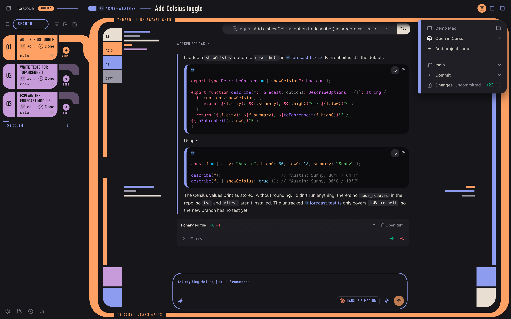
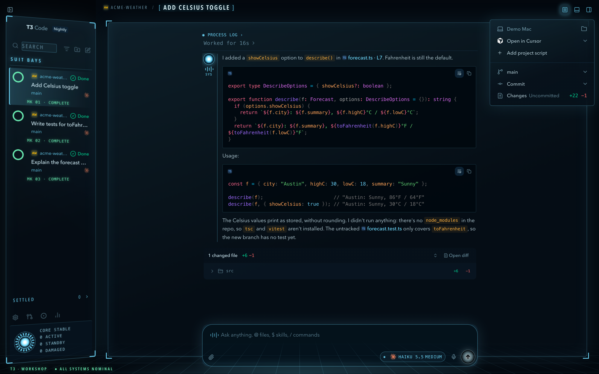
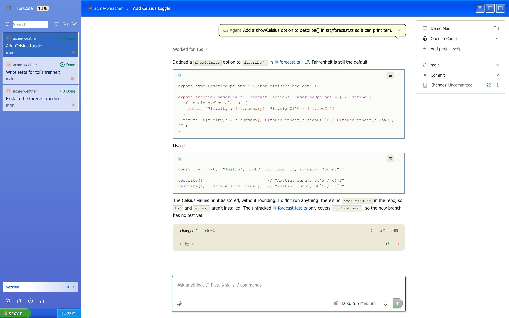

# T3 Code themes

Custom themes for [T3 Code](https://github.com/pingdotgg/t3code) that restyle the whole app, not just its colors.

| Theme | Id | Look |
| --- | --- | --- |
| [LCARS](themes/lcars) | `lcars` | Starfleet LCARS console: elbow frames, pill buttons, numbered panels |
| [Workshop](themes/workshop) | `workshop` | Holographic garage workshop: 3D-tilted side walls, arc-reactor status, voice waveform composer |
| [Luna XP](themes/windows-xp) | `windows-xp` | Early-2000s desktop look: blue title bars, glossy buttons, light theme |

Each theme's folder has its own README with screenshots and a one-step install for just that theme.

| LCARS | Workshop | Luna XP |
| --- | --- | --- |
| [](themes/lcars) | [](themes/workshop) | [](themes/windows-xp) |

## Install

### Ask your agent

Copy this prompt into a coding agent (in T3 or a terminal). Change the first line to the theme id you want, or leave it as `all` to get every theme and pick one later.

```text
Theme: all

Install T3 Code themes from https://github.com/zolem/t3-themes.
1. If ~/t3-themes exists, run `git -C ~/t3-themes pull`. Otherwise run `git clone https://github.com/zolem/t3-themes.git ~/t3-themes`.
2. If "Theme" above is `all`, run `~/t3-themes/scripts/install.sh`. Otherwise run `~/t3-themes/scripts/install.sh <id>` with that id. The ids are listed in the table in ~/t3-themes/README.md.
3. If you have T3's `t3_theme_set` tool and I named one theme, switch to it with `{ "themeId": "<id>" }`. Otherwise tell me which themes were installed and that I can pick one in T3's appearance settings.
4. Follow ~/t3-themes/.claude/skills/t3-themes/SKILL.md for anything else, such as editing a theme or saving changes back.
```

### By hand

```sh
git clone https://github.com/zolem/t3-themes.git
cd t3-themes
./scripts/install.sh            # all themes
./scripts/install.sh workshop   # just one
```

Themes are copied into `~/.t3/userdata/themes/`. Pick one in T3's appearance settings.

## Save changes made in T3

After editing a theme in T3 (or asking an agent to), copy it back into the repo and commit:

```sh
./scripts/pull.sh workshop   # or no id to pull every theme already in this repo
git add themes && git commit -m "Tune workshop"
```

Both scripts also copy a theme's background image if it has one. To add a new theme to the repo, pull it by id: `./scripts/pull.sh my-theme`.

## Screenshots

Screenshots come from a separate demo copy of T3 filled with fake data, so your own projects, threads and machine name never show up:

```sh
cd scripts/screenshots
npm install && npx playwright install chromium   # first time only
npm run shoot                    # every theme
npm run shoot -- workshop        # one theme
npm run demo                     # open the demo copy in your own browser
```

`npm run shoot` saves three screenshots per theme in `themes/<id>/screenshots/`:

- `new-thread.png`: the new-thread screen.
- `thread.png`: a thread with the details panel.
- `panels.png`: the same thread with the terminal and right panel open.

`npm run demo` keeps the demo copy running and prints a sign-in link. Switch themes there with `t3 theme set` (it prints the exact command).

- **Where the data lives:** the demo copy stays in `~/.t3-themes-demo` between runs (set `T3_THEMES_DEMO_DIR` to move it). It never touches `~/.t3`.
- **Demo data:** the first run adds a fake project (`acme-weather`, from `scripts/screenshots/demo-project/`) and three threads. It makes those threads by running real agent turns with a small model, which costs a few cents. To use a different model, set `SEED_PROVIDER` and `SEED_MODEL`. Use `--reseed` to start over.
- **Machine name and terminal:** the demo copy reports "Demo Mac" as the machine name. Its terminals use a demo shell config with a `demo@acme-weather` prompt instead of your `~/.zshrc`.
- **Privacy check:** before saving each screenshot, the tool replaces your username and home folder on the page and checks the page text again. It refuses to save if anything is left, or if the terminal didn't load the demo shell config. Look at the screenshots anyway before committing.

## Agent skill

`.claude/skills/t3-themes/SKILL.md` teaches coding agents (Claude Code, or any agent running in T3) how to install, switch, edit, create and save these themes, including the CSS limits below.

## Layout

```
themes/<id>/
  theme.json          the theme (installed as <id>.json in T3)
  background.jpg      optional background image (.jpg, .png or .webp; installed as <id>.jpg)
  README.md           description and install steps for this theme
  screenshots/        new-thread.png, thread.png and panels.png, made by scripts/screenshots
```

## Theme file format

Each `theme.json` is a JSON object with `name`, `appearance` (`dark` or `light`), `canvas`, `accent`, `colors` and an optional `css` string (up to 50k characters).

Notes for the `css` field:

- Rules containing a backslash are dropped. Use raw characters (for example a real non-breaking space) instead of escapes like `\A` or `\00a0`.
- The right panel's browser is a native view, so CSS transforms can't move it. Workshop flattens its tilt while a browser tab is open.
