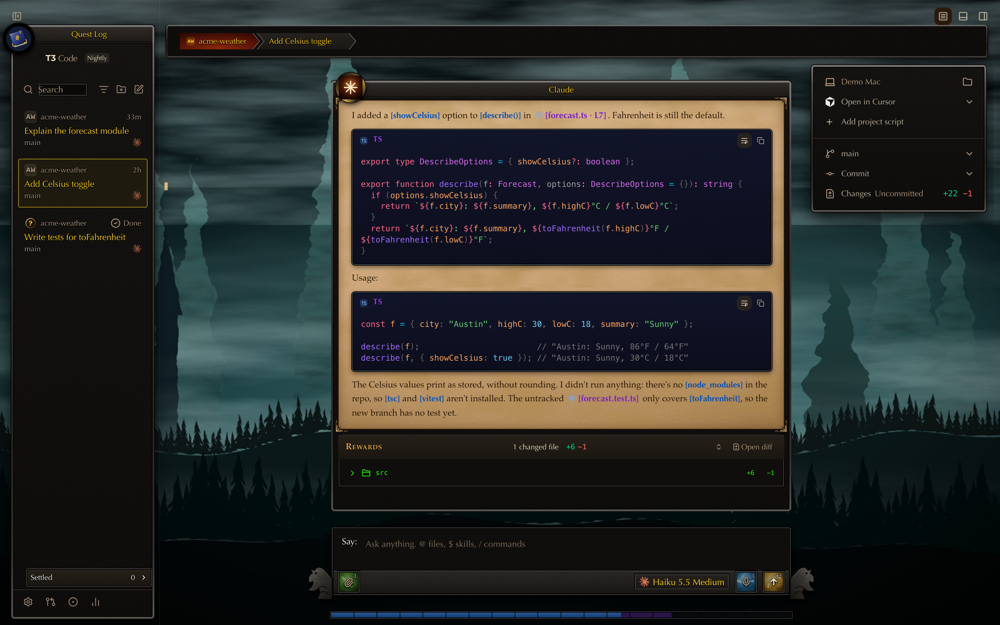
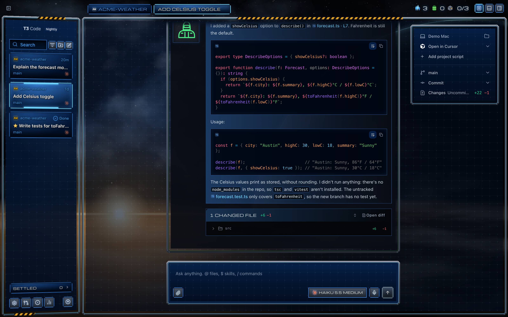
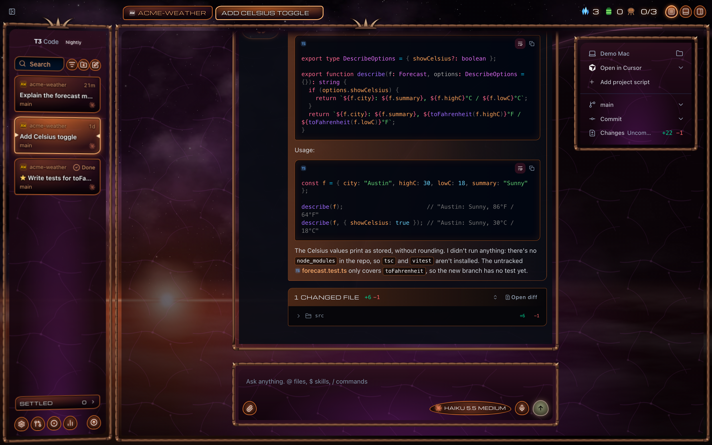
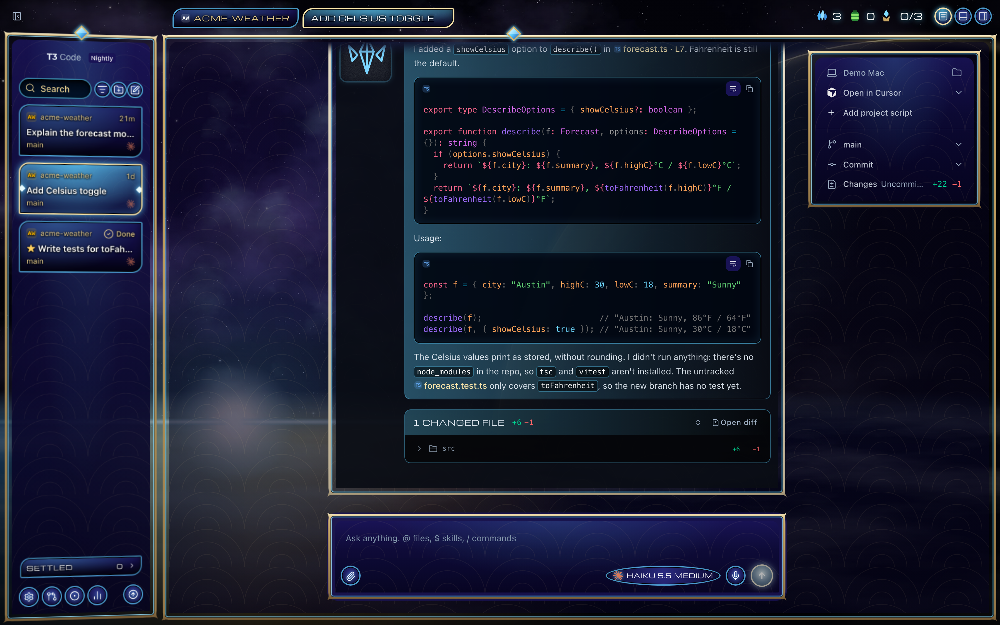

# T3 Code themes

Custom themes for [T3 Code](https://github.com/pingdotgg/t3code) that restyle the whole app, not just its colors.

| Theme | Id | Look |
| --- | --- | --- |
| [LCARS](themes/lcars) | `lcars` | Starfleet LCARS console: elbow frames, pill buttons, numbered panels |
| [Workshop](themes/workshop) | `workshop` | Holographic garage workshop: 3D-tilted side walls, arc-reactor status, voice waveform composer |
| [Luna XP](themes/windows-xp) | `windows-xp` | Early-2000s desktop look: blue title bars, glossy buttons, light theme |
| [Azeroth](themes/azeroth) | `azeroth` | Fantasy MMO game screen: quest log sidebar, parchment replies, action-bar composer, misty world background |
| [StarCraft: Terran](themes/starcraft-terran) | `starcraft-terran` | Sci-fi RTS console: bolted gunmetal frames, hazard stripes, tilted side panels, live resource bar, space background |
| [StarCraft: Zerg](themes/starcraft-zerg) | `starcraft-zerg` | The same RTS console grown from chitin: bone horns, creep veins, organic panels, bile-green controls |
| [StarCraft: Protoss](themes/starcraft-protoss) | `starcraft-protoss` | The same RTS console in gold and crystal: swept gold frames, cyan glow, leaf-shaped buttons |

Each theme's folder has its own README with screenshots and a one-step install for just that theme.

## Requirements

| Feature | T3 Code version |
| --- | --- |
| Themes with CSS (every theme here) | v0.1.10, or nightly 20261114.4669 or later |
| Background image files (Azeroth, StarCraft) | v0.1.10, or nightly 20261116.4800 or later |
| `css` over 50,000 characters, up to 100,000 | nightly 20261117.4825 or later; no stable release yet |

Every theme here keeps its `css` under 50,000 characters, so all of them work on v0.1.10. A theme that needs a newer build says so in its README.

| LCARS | Workshop | Luna XP | Azeroth |
| --- | --- | --- | --- |
| [](themes/lcars) | [](themes/workshop) | [](themes/windows-xp) | [](themes/azeroth) |

| StarCraft: Terran | StarCraft: Zerg | StarCraft: Protoss |
| --- | --- | --- |
| [](themes/starcraft-terran) | [](themes/starcraft-zerg) | [](themes/starcraft-protoss) |

## Install

### Ask your agent

Copy this prompt into a coding agent (in T3 or a terminal). Change the first line to the theme id you want, or leave it as `all` to get every theme and pick one later.

```text
Theme: all

Install T3 Code themes from https://github.com/zolem/t3-themes.
1. If ~/t3-themes exists, run `git -C ~/t3-themes pull`. Otherwise run `git clone https://github.com/zolem/t3-themes.git ~/t3-themes`.
2. If "Theme" above is `all`, run `~/t3-themes/scripts/install.sh`. Otherwise run `~/t3-themes/scripts/install.sh <id>` with that id. The ids are listed in the table in ~/t3-themes/README.md.
3. If you have T3's `t3_theme_set` tool and I named one theme, switch to it with `{ "themeId": "<id>" }`. Otherwise tell me which themes were installed and that I can pick one in T3's appearance settings.
4. Follow ~/t3-themes/.claude/skills/t3-themes/SKILL.md for anything else, such as editing a theme or saving changes back.
```

### By hand

```sh
git clone https://github.com/zolem/t3-themes.git
cd t3-themes
./scripts/install.sh            # all themes
./scripts/install.sh workshop   # just one
```

Themes are copied into `~/.t3/userdata/themes/`. Pick one in T3's appearance settings.

## Save changes made in T3

After editing a theme in T3 (or asking an agent to), copy it back into the repo and commit:

```sh
./scripts/pull.sh workshop   # or no id to pull every theme already in this repo
git add themes && git commit -m "Tune workshop"
```

Both scripts also copy a theme's background image if it has one. To add a new theme to the repo, pull it by id: `./scripts/pull.sh my-theme`.

## Screenshots and the demo copy

Screenshots come from a separate demo copy of T3 filled with fake data, so your own projects, threads and machine name never show up. The demo copy lives in its own folder, `~/.t3-themes-demo`, and never touches your real T3 data in `~/.t3`.

### Set up once

You need:

- Node 18 or later.
- T3 Code v0.1.10 or later (see Requirements).
- T3's `t3` command. In the desktop app, open Settings, find the row that says "Run T3 Code's CLI as `t3` from any terminal" (search settings for "CLI"), and click Install. If `t3` is installed somewhere else, set `T3_BIN` to its path.
- A provider set up in T3 that can run a small model. The demo data uses Claude Haiku by default. To use another, set `SEED_PROVIDER` to a provider instance id and `SEED_MODEL` to a model slug.

Then run:

```sh
cd scripts/screenshots
npm install
npm run setup
```

`npm run setup` checks your Node and T3 versions, lists which theme features your T3 supports, installs the headless Chromium that Playwright uses, and creates the demo copy. Creating it runs three short agent turns to make the demo threads, which costs a few cents. Run it again any time to recheck; it skips what's already done. `npm run setup -- --reseed` starts the demo data over.

### Take the repo screenshots

```sh
npm run shoot                    # every theme
npm run shoot -- workshop        # one theme
```

`npm run shoot` saves three screenshots per theme in `themes/<id>/screenshots/`:

- `new-thread.png`: the new-thread screen.
- `thread.png`: a thread with the details panel.
- `panels.png`: the same thread with the terminal and right panel open.

### Working on a theme

`npm run dev` lets you (or an agent) see a theme in the demo copy while you build it, without touching your own T3. A theme can be a repo id or a path to any theme JSON file. A background image beside the file (`background.jpg`, or `<name>.jpg`, `.png` or `.webp`) goes with it.

```sh
npm run demo                                     # keep the demo copy running, and open it in your browser
npm run demo -- ~/work/my-theme.json             # the same, switched to your theme
npm run dev -- shot ~/work/my-theme.json         # screenshot the new-thread, thread and panels views
npm run dev -- shot my-theme thread menu settings          # pick views
npm run dev -- shot my-theme thread --state Failed         # show the thread's sidebar row as failed
npm run dev -- turn my-theme                     # screenshot a real agent turn while it works and as it ends
npm run dev -- eval my-theme probes/survey.js panels       # run a script in the page and print the result
npm run dev -- run my-theme my-script.mjs        # run your own Playwright script: hover, scroll, resize, measure
```

- **Views:** `new`, `thread`, `panels`, `menu` (the model picker open) and `settings`.
- **States:** `--state` adds a status word (`Working`, `Approval`, `Input`, `Failed`, `Done` and so on) to the shown thread's sidebar row, so you can check state styles without waiting for one. `turn` sends one short real turn to a different demo thread, which costs a fraction of a cent, and takes screenshots from 0.1 s to 4 s after it starts and ends to catch animations.
- **Output:** screenshots go to `~/.t3-themes-demo/shots/<id>/` (change it with `--out`), never into the repo. Use `--width`, `--height` and `--scale` for other sizes.
- **Probes:** `probes/survey.js` lists every `data-*` hook on the page, `probes/opaque.js` lists solid layers that would hide a background image, and `probes/states.js` shows each sidebar row's status words. An eval script is the body of an async function, so it ends with `return`.
- **Playwright scripts:** for anything the views don't cover, such as hovering for a tooltip, scrolling, resizing the sidebar or maximizing a panel, `run` takes a module whose default export gets the Playwright `page` and the tool's helpers (`views`, `fakeState`, and `shot`, which saves a privacy-checked screenshot). `probes/example-run.mjs` shows one.
- **Speed:** while `npm run demo` is running, the other commands reuse it. Otherwise each one starts its own demo server and stops it when done.

Notes on the demo copy:

- **Where the data lives:** the demo copy stays in `~/.t3-themes-demo` between runs (set `T3_THEMES_DEMO_DIR` to move it). It never touches `~/.t3`.
- **Demo data:** setup adds a fake project (`acme-weather`, from `scripts/screenshots/demo-project/`) and three threads. If the demo copy is missing, any other command creates it the same way first.
- **Machine name and terminal:** the demo copy reports "Demo Mac" as the machine name. Its terminals use a demo shell config with a `demo@acme-weather` prompt instead of your `~/.zshrc`.
- **Privacy check:** before saving each screenshot, the tool replaces your username and home folder on the page and checks the page text again. It refuses to save if anything is left, or if the terminal didn't load the demo shell config. Look at the screenshots anyway before committing.

## Agent skill

`.claude/skills/t3-themes/SKILL.md` teaches coding agents (Claude Code, or any agent running in T3) how to install, switch, edit, create and save these themes, including the CSS limits below.

`.claude/skills/build-t3-theme/SKILL.md` is for contributors making a new theme. It walks an agent through the process used for every theme here: pitch the idea, build an HTML mockup, build the real theme in the demo copy, polish it in the real app, and ship it with screenshots and a README. Its `reference.md` lists the selectors, techniques and CSS limits found so far.

Run `./scripts/check.py` before committing a theme. It catches what T3 would reject or silently drop, such as a backslash in the CSS.

## Layout

```
themes/<id>/
  theme.json          the theme (installed as <id>.json in T3)
  background.jpg      optional background image (.jpg, .png or .webp; installed as <id>.jpg)
  README.md           description and install steps for this theme
  screenshots/        new-thread.png, thread.png and panels.png, made by scripts/screenshots
```

## Theme file format

Each `theme.json` is a JSON object with `name`, `appearance` (`dark` or `light`), `canvas`, `accent`, `colors` and an optional `css` string. `css` can hold up to 100,000 characters on nightly 20261117.4825 or later, and 50,000 on older builds (see Requirements).

Notes for the `css` field:

- Rules containing a backslash are dropped. Use raw characters (for example a real non-breaking space) instead of escapes like `\A` or `\00a0`.
- The right panel's browser is a native view, so CSS transforms can't move it. Workshop flattens its tilt while a browser tab is open.
