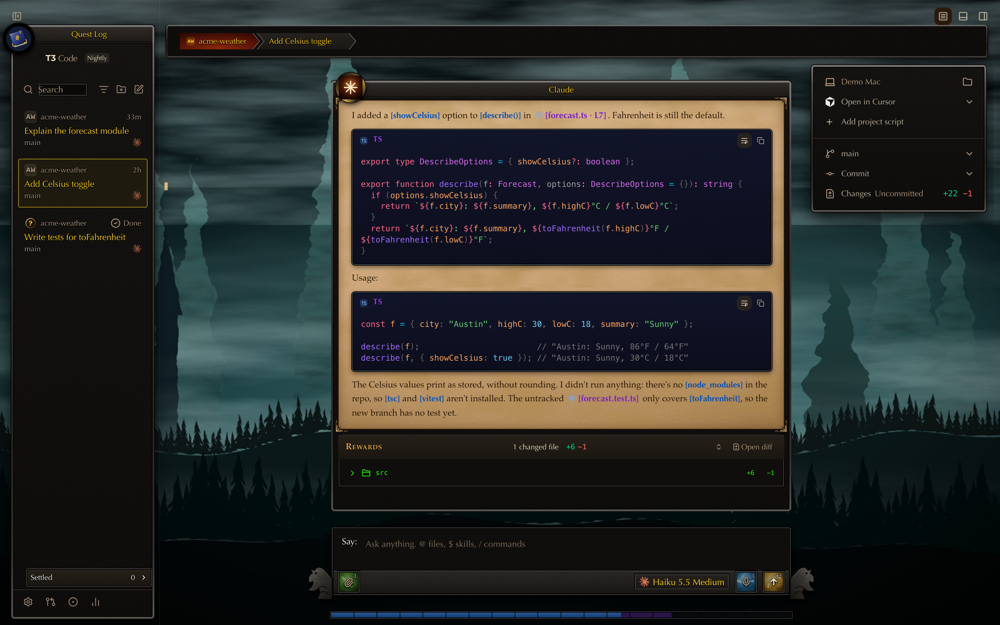
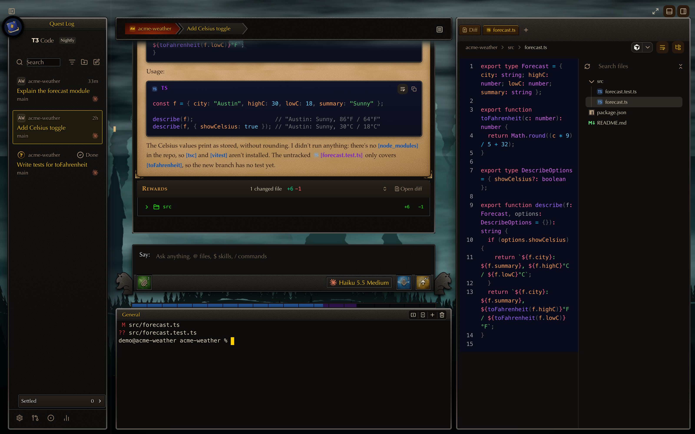
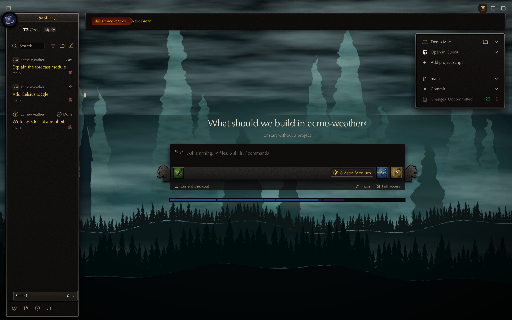

# Azeroth

A fantasy MMO game screen. Dark stone windows with gold titles sit over a misty world of stone spires. The sidebar is a quest log, Claude's replies are parchment quest text, and the composer is a chat box over an action bar.

- Id: `azeroth`
- Appearance: dark







## What changes with a thread's state

- **Working:** the thread gets the In Progress quest icon, and a cast bar fills above the composer.
- **Done:** the thread gets the gold Turn In `?` icon, and its row flashes gold once.
- **Needs approval or input:** the thread gets a purple Important icon, and the screen edges pulse purple.
- **Failed:** the thread gets a red shield, the world turns grey-blue, and the screen edges pulse red like low health.

## Install

This theme has a background image, so it needs two files.

### Ask your agent

Copy this prompt into a coding agent (in T3 or a terminal):

```text
Install the Azeroth theme for T3 Code.
1. Download https://raw.githubusercontent.com/zolem/t3-themes/main/themes/azeroth/theme.json and save it as ~/.t3/userdata/themes/azeroth.json. Create the folder if it doesn't exist.
2. Download https://raw.githubusercontent.com/zolem/t3-themes/main/themes/azeroth/background.jpg and save it as ~/.t3/userdata/themes/azeroth.jpg.
3. If you have T3's `t3_theme_set` tool, switch to it with { "themeId": "azeroth" }. Otherwise tell me to pick "Azeroth" in T3's appearance settings.
```

### By hand

```sh
mkdir -p ~/.t3/userdata/themes
curl -fsSL https://raw.githubusercontent.com/zolem/t3-themes/main/themes/azeroth/theme.json -o ~/.t3/userdata/themes/azeroth.json
curl -fsSL https://raw.githubusercontent.com/zolem/t3-themes/main/themes/azeroth/background.jpg -o ~/.t3/userdata/themes/azeroth.jpg
```

Then pick **Azeroth** in T3's appearance settings. If it was already selected, reselect it to load the new file.

To go back, pick any built-in theme.

## Notes

- All the art is original: the frames, icons and gryphons are drawn in CSS and SVG, and the background was drawn as SVG and saved as a JPG. No game art is used.
- The theme uses Friz Quadrata for its text if it's installed on your computer. Otherwise it falls back to Optima, then Georgia.
- Turn on reduced motion in your system settings to stop the fog, camera drift and pulses.
