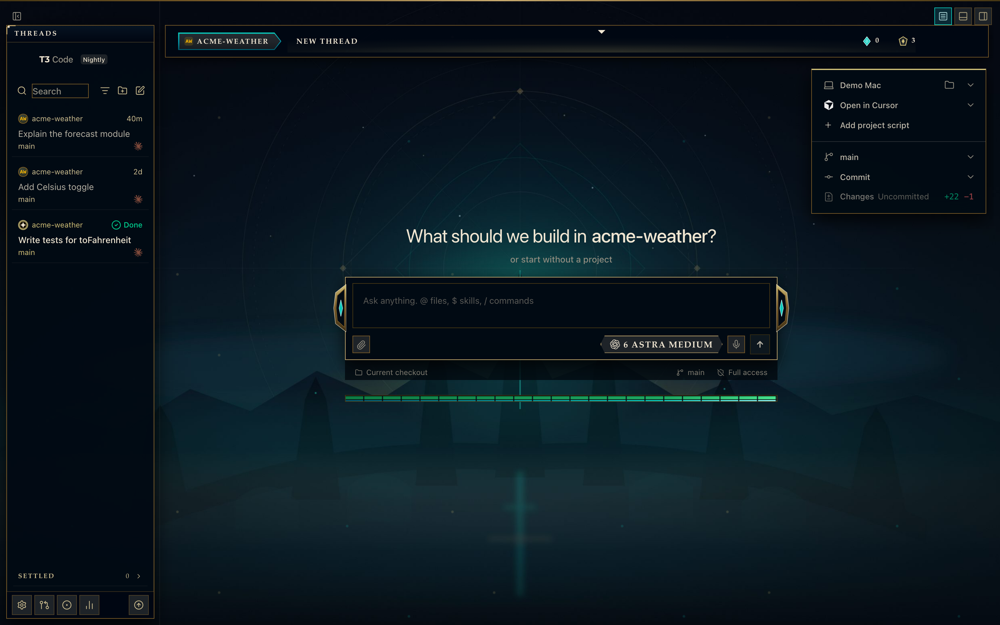
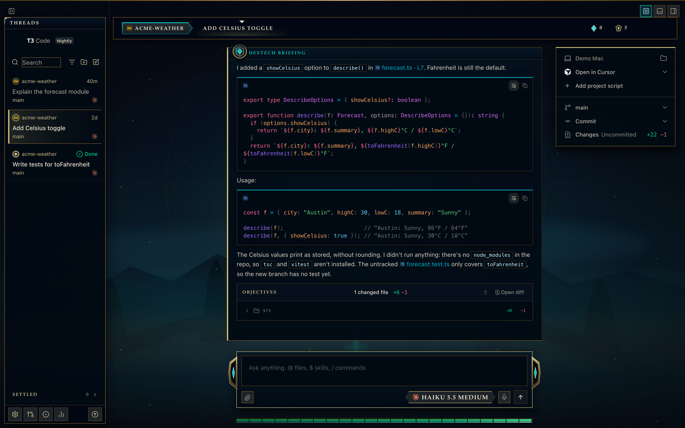
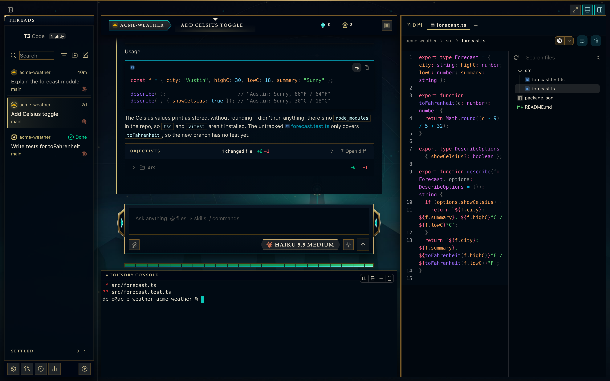

# Hextech

An Art Deco hextech fantasy MOBA client and in-game HUD. Deep obsidian panels with antique bronze hairlines, champagne-gold selection bars and glowing cyan accents sit over a misty twilight citadel and astrolabe background. The sidebar becomes a roster list with circular medallions, the header turns the project breadcrumb into a chamfered play badge with live thread counters, replies become obsidian briefing cards, and the composer becomes a winged ability bar over segmented health and mana strips.

- Id: `hextech`
- Appearance: dark and light (obsidian & gold in dark mode; crisp white relic stone, charcoal armor headers, and radiant gold in light mode)

| New thread | Thread | Panels |
| --- | --- | --- |
|  |  |  |

## What changes with a thread's state

- **Selected:** the thread row gets a warm gold left accent bar with top and bottom bronze hairlines, and its circular medallion lights up in champagne gold.
- **Working:** the thread row's medallion pulses cyan with a sweeping progress line along its base, a **CHANNELING · GENERATING RESPONSE** cast bar fills above the composer, and the header's cyan active counter increments.
- **Turn finished:** when the thread you're watching finishes a turn, a winged gold-and-cyan **VICTORY** emblem snaps open over the conversation and fades out. Threads that finish while you're elsewhere flash gold once and swap their medallion to a gold honor star.
- **Needs approval or input:** the thread row glows cyan-gold with a ready-check diamond, the viewport edges pulse cyan-gold, and **◆ MATCH FOUND · ACTION REQUIRED ◆** flashes across the top of the conversation.
- **Failed:** the thread row shifts to crimson with a red `✕` medallion, the background desaturates, the viewport edges pulse red, and **✕ DEFEAT · TURN INTERRUPTED ✕** marks the top of the conversation.

The header counters read the sidebar live via CSS counters: the cyan diamond counts working threads and the gold crest counts total threads.

## Install

This theme has a background image, so it needs two files.

### Ask your agent

Copy this prompt into a coding agent (in T3 or a terminal):

```text
Install the Hextech theme for T3 Code.
1. Download https://raw.githubusercontent.com/zolem/t3-themes/main/themes/hextech/theme.json and save it as ~/.t3/userdata/themes/hextech.json. Create the folder if it doesn't exist.
2. Download https://raw.githubusercontent.com/zolem/t3-themes/main/themes/hextech/background.jpg and save it as ~/.t3/userdata/themes/hextech.jpg.
3. If you have T3's `t3_theme_set` tool, switch to it with { "themeId": "hextech" }. Otherwise tell me to pick "Hextech" in T3's appearance settings.
```

### By hand

```sh
mkdir -p ~/.t3/userdata/themes
curl -fsSL https://raw.githubusercontent.com/zolem/t3-themes/main/themes/hextech/theme.json -o ~/.t3/userdata/themes/hextech.json
curl -fsSL https://raw.githubusercontent.com/zolem/t3-themes/main/themes/hextech/background.jpg -o ~/.t3/userdata/themes/hextech.jpg
```

Then pick **Hextech** in T3's appearance settings. If it was already selected, reselect it to load the new file.

To go back, pick any built-in theme.

## Notes

- All art is original: the frames, winged composer guards, victory emblem, medallions and icons are drawn in CSS and SVG, and the background was drawn as SVG and rendered to a 2560×1600 JPG. No game art, logos or screenshots are used.
- Display headings use Beaufort for LOL if it is installed on your computer, falling back to Cinzel, Palatino, then Georgia. Body text uses Spiegel if installed, falling back to the system UI font. Code and terminal stay monospace.
- The right panel stays completely flat so T3's native browser surface aligns cleanly without transform clipping.
- Turn on reduced motion in your system settings to stop the background drift, floating motes, pulses, sweeps and transition banners.
