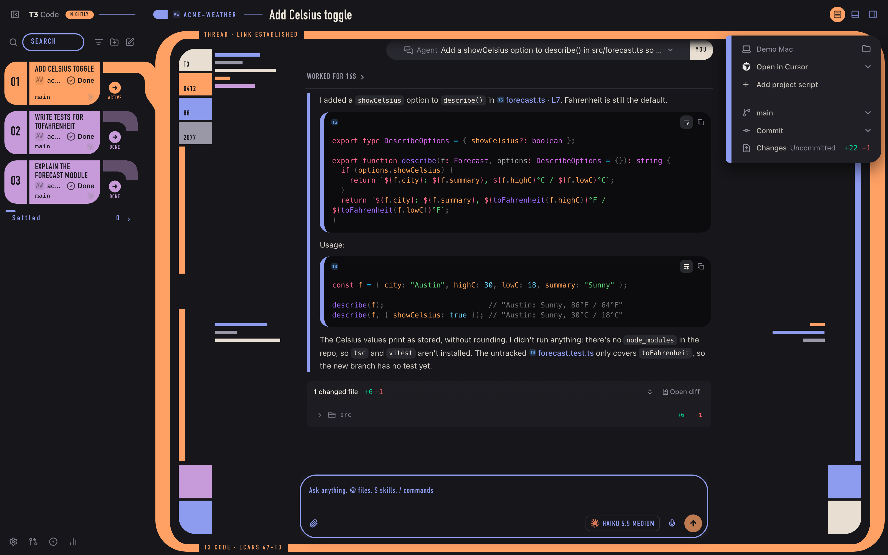
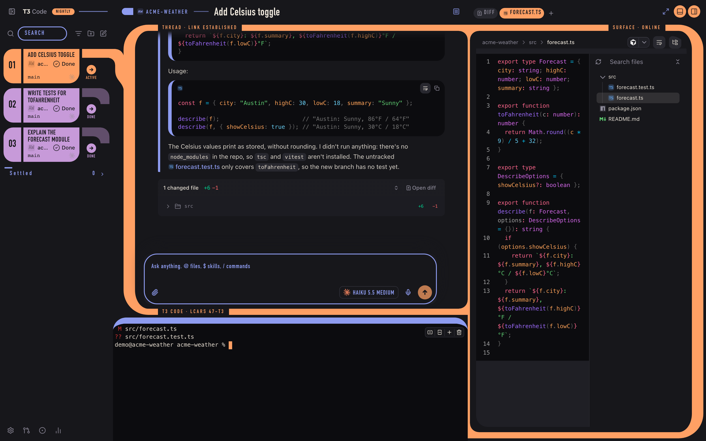
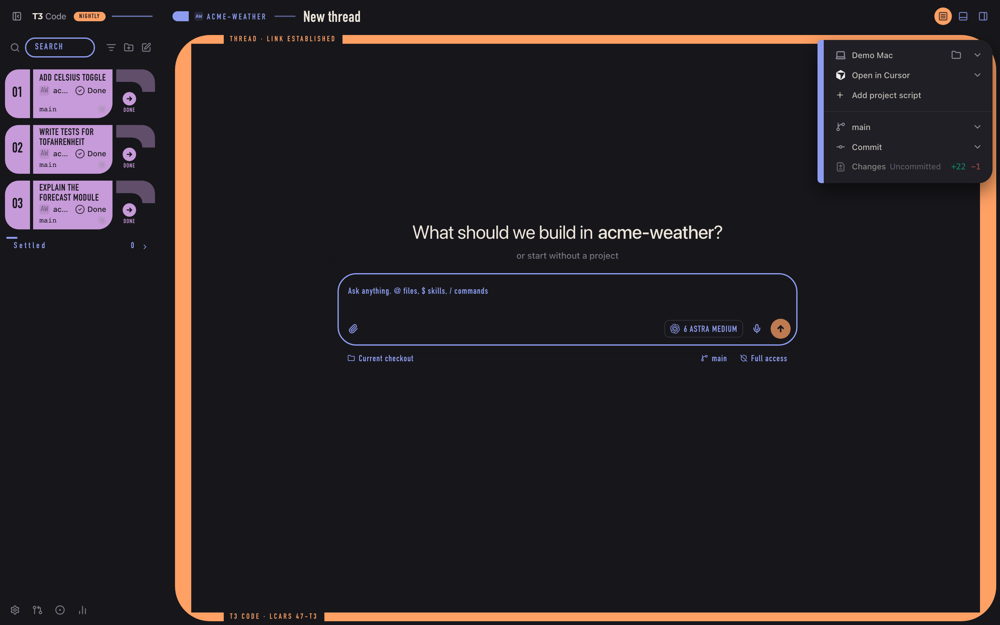

# LCARS

A Starfleet LCARS console: elbow frames around the app, pill-shaped buttons and numbered panels.

- Id: `lcars`
- Appearance: dark







## Install

### Ask your agent

Copy this prompt into a coding agent (in T3 or a terminal):

```text
Install the LCARS theme for T3 Code.
1. Download https://raw.githubusercontent.com/zolem/t3-themes/main/themes/lcars/theme.json and save it as ~/.t3/userdata/themes/lcars.json. Create the folder if it doesn't exist.
2. If you have T3's `t3_theme_set` tool, switch to it with { "themeId": "lcars" }. Otherwise tell me to pick "LCARS" in T3's appearance settings.
```

### By hand

```sh
mkdir -p ~/.t3/userdata/themes
curl -fsSL https://raw.githubusercontent.com/zolem/t3-themes/main/themes/lcars/theme.json -o ~/.t3/userdata/themes/lcars.json
```

Then pick **LCARS** in T3's appearance settings. If it was already selected, reselect it to load the new file.

To go back, pick any built-in theme.
