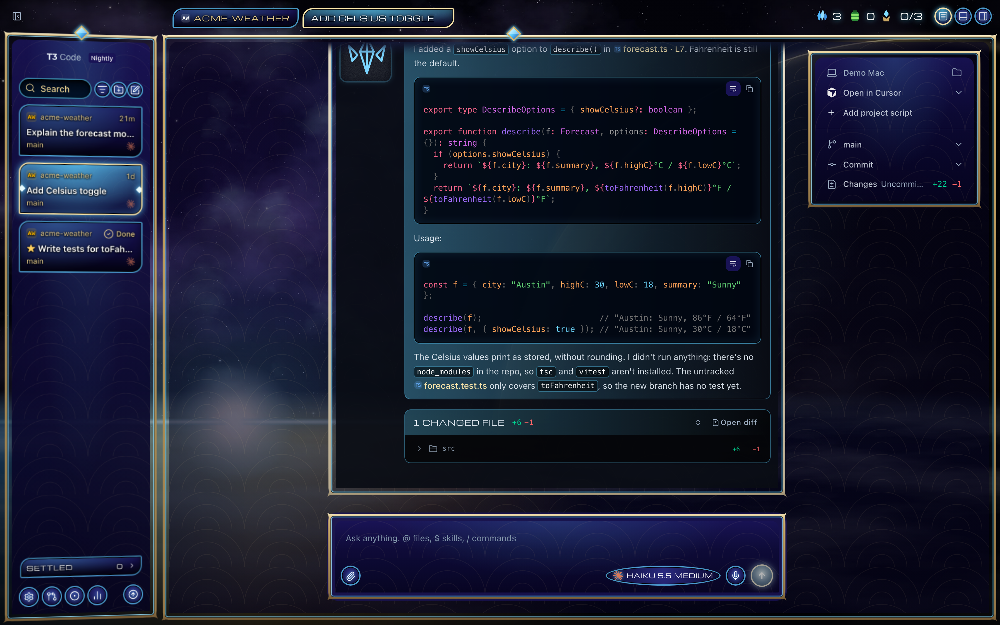
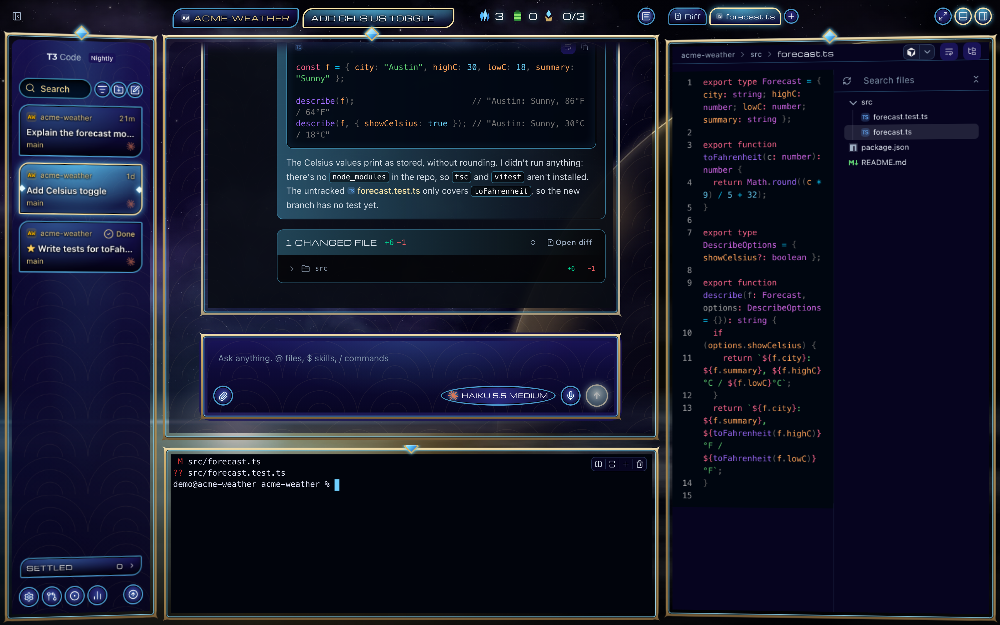
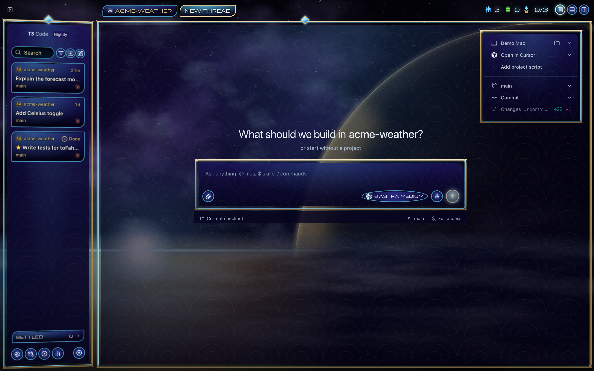

# StarCraft: Protoss

A sci-fi RTS console in the style of StarCraft II's menus, with Protoss parts. The panels are glowing, bevelled console windows over a space scene, and the sidebar and right panel lean in toward the middle. Threads are menu buttons, Claude's replies are transmission cards with an animated static portrait, and the header shows a live resource bar.

Gold frames with swept corner points and a cyan inner line, blue crystals on the panel tops, leaf-shaped buttons, round gold-rimmed controls and a faint arc pattern on indigo. The background is a violet nebula, a gold-lit planet and a blue-white sun over a sea of clouds.

This theme is one of three that share a layout: see [Terran](../starcraft-terran) and [Zerg](../starcraft-zerg).

- Id: `starcraft-protoss`
- Appearance: dark







## What changes with a thread's state

- **Selected:** the thread's button glows, with glowing diamonds on both ends.
- **Working:** the thread's button gets a shimmering cyan bar, and a **WARPING IN…** bar fills above the composer. The resource bar's gas and supply counts go up.
- **Turn finished:** when the thread you're watching finishes a turn, an **OBJECTIVE COMPLETE** banner snaps open over the conversation and fades out, and a white-blue warp flash bursts behind the banner. Threads that finish while you're elsewhere flash once and get a ★.
- **Needs approval or input:** the thread's button turns cyan with a pinging marker, the screen edges pulse, and **AWAITING ORDERS** flashes at the top.
- **Failed:** the thread's button turns red and flickers, the background dims, the screen edges pulse red, and **OBJECTIVE FAILED** shows at the top.

The resource bar in the header counts the threads in your sidebar: crystals are all threads, gas is working threads, and supply is working out of total.

## Install

This theme has a background image, so it needs two files.

### Ask your agent

Copy this prompt into a coding agent (in T3 or a terminal):

```text
Install the StarCraft Protoss theme for T3 Code.
1. Download https://raw.githubusercontent.com/zolem/t3-themes/main/themes/starcraft-protoss/theme.json and save it as ~/.t3/userdata/themes/starcraft-protoss.json. Create the folder if it doesn't exist.
2. Download https://raw.githubusercontent.com/zolem/t3-themes/main/themes/starcraft-protoss/background.jpg and save it as ~/.t3/userdata/themes/starcraft-protoss.jpg.
3. If you have T3's `t3_theme_set` tool, switch to it with { "themeId": "starcraft-protoss" }. Otherwise tell me to pick "Protoss" in T3's appearance settings.
```

### By hand

```sh
mkdir -p ~/.t3/userdata/themes
curl -fsSL https://raw.githubusercontent.com/zolem/t3-themes/main/themes/starcraft-protoss/theme.json -o ~/.t3/userdata/themes/starcraft-protoss.json
curl -fsSL https://raw.githubusercontent.com/zolem/t3-themes/main/themes/starcraft-protoss/background.jpg -o ~/.t3/userdata/themes/starcraft-protoss.jpg
```

Then pick **Protoss** in T3's appearance settings. If it was already selected, reselect it to load the new file.

To go back, pick any built-in theme.

## Notes

- This is a fan theme. It isn't affiliated with or endorsed by Blizzard Entertainment. All the art is original: the frames, glyphs and icons are drawn in CSS and SVG, and the background was painted as SVG and saved as a JPG. No game art, logos or screenshots are used.
- The wide lettering uses Eurostile Extended if it's installed on your computer. Otherwise it uses a small ASCII subset of [Michroma](https://github.com/googlefonts/Michroma-font), which is embedded in the theme under the SIL Open Font License (see [OFL.txt](OFL.txt)).
- The right panel's browser is a native view that CSS can't move, so the right panel's tilt flattens while a browser tab is open.
- Turn on reduced motion in your system settings to stop the pulses, spinners and banners.
