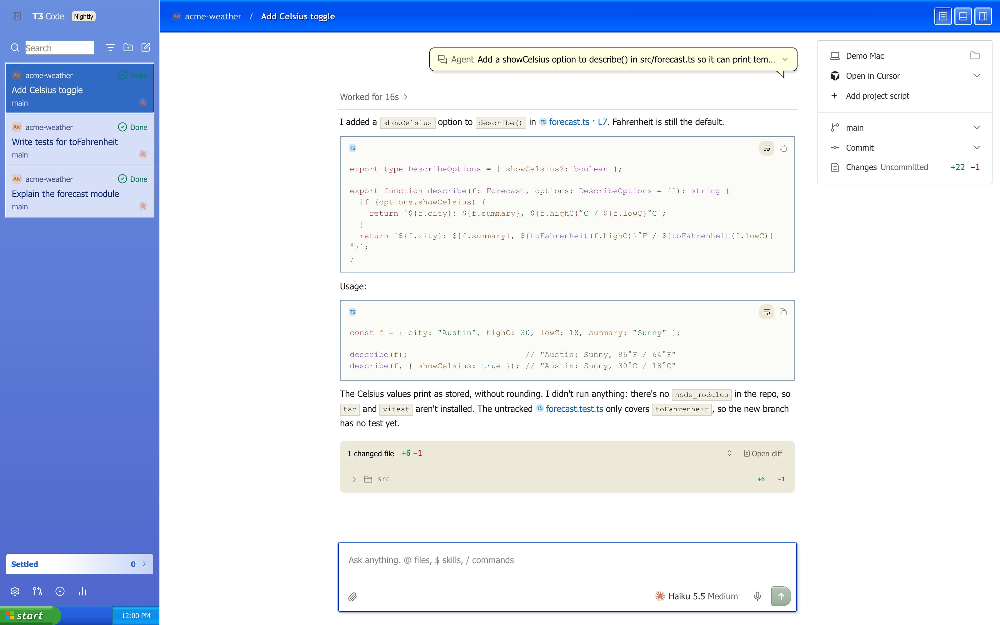
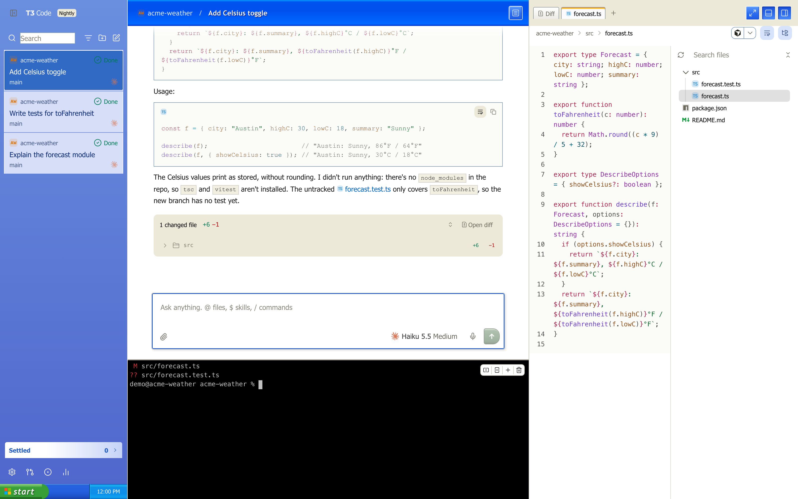
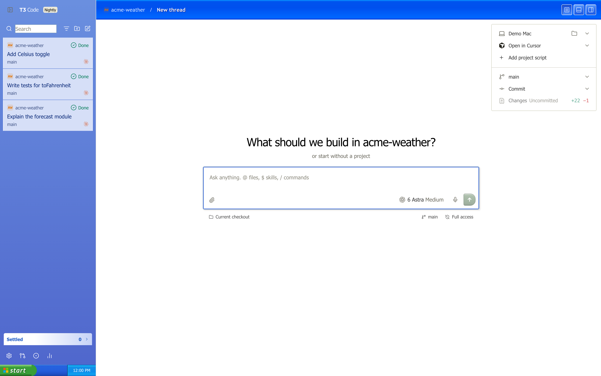

# Luna XP

An early-2000s desktop look: blue title bars, glossy buttons and a light palette.

- Id: `windows-xp`
- Appearance: light







## Install

### Ask your agent

Copy this prompt into a coding agent (in T3 or a terminal):

```text
Install the Luna XP theme for T3 Code.
1. Download https://raw.githubusercontent.com/zolem/t3-themes/main/themes/windows-xp/theme.json and save it as ~/.t3/userdata/themes/windows-xp.json. Create the folder if it doesn't exist.
2. If you have T3's `t3_theme_set` tool, switch to it with { "themeId": "windows-xp" }. Otherwise tell me to pick "Luna XP" in T3's appearance settings.
```

### By hand

```sh
mkdir -p ~/.t3/userdata/themes
curl -fsSL https://raw.githubusercontent.com/zolem/t3-themes/main/themes/windows-xp/theme.json -o ~/.t3/userdata/themes/windows-xp.json
```

Then pick **Luna XP** in T3's appearance settings. If it was already selected, reselect it to load the new file.

To go back, pick any built-in theme.
